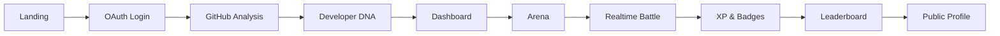
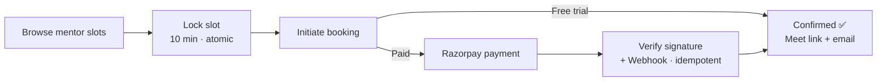

<!-- ═══════════════ HEADER ═══════════════ -->
<div align="center">


<a href="https://git.io/typing-svg">
  
</a>

<br/>

<a href="https://www.linkedin.com/in/vivek-jadhav27/"></a>
<a href="https://x.com/vivekjadha30076"></a>
<a href="mailto:vivek.jadhav200127@gmail.com"></a>


</div>

<br/>

<!-- ═══════════════ ABOUT ═══════════════ -->
## 👋 About Me

<table>
<tr>
<td width="60%" valign="top">

```yaml
name: Vivek Jadhav
role: Full Stack MERN Developer
origin: Mechanical Engineer → Developer
focus: Performance · Scalability · Clean UI
shipped: [DevArena, The Code Alchemist]
learning: [DSA, Backend, System Design]
mode: Learn by building real products
```

</td>
<td width="40%" valign="top">

🔭 **Working on** — full-stack MERN apps built for performance & scale

👯 **Collaborating on** — web apps, social products & frontend projects

🤝 **Seeking help with** — system design, backend scalability, production practices

💬 **Ask me about** — React, JavaScript, MERN, frontend architecture

</td>
</tr>
</table>

<br/>

<!-- ═══════════════ FEATURED PROJECTS ═══════════════ -->
## 🚀 Featured Projects

<div align="center">

<a href="https://github.com/VivekJadhav2001/Dev-Arena">
  
</a>
<a href="https://github.com/VivekJadhav2001/The-Code-Alchemist">
  
</a>

</div>

<br/>

---

### ⚔️ DevArena — *Proof of skill, not just a profile*

<div align="center">

<a href="https://dev-arena-plum.vercel.app/"></a>
<a href="https://dev-arena-62si.onrender.com/api/v1"></a>
<a href="https://github.com/VivekJadhav2001/Dev-Arena"></a>

</div>

A developer identity + competitive coding platform. Sign in with GitHub or Google, get your GitHub analyzed into a deterministic **Developer DNA**, then battle other developers in realtime **1v1 duels and royale rooms** to earn **XP, badges, and leaderboard rank**.

| | Feature | What it does |
|---|---|---|
| 🔐 | **OAuth login** | GitHub / Google via Passport session cookies — no JWT, no browser-stored tokens |
| 🧬 | **Developer DNA** | Deterministic persona + traits from real GitHub activity — same data, same DNA, no AI API |
| 📥 | **GitHub intelligence** | Repos, languages, commits, streaks & heatmaps imported in background, cached in MongoDB |
| 🎁 | **Wrapped** | Animated season recap with PNG poster export + native / X / LinkedIn sharing |
| ⚔️ | **Arena** | Create, join or quick-match 1v1 & royale battles; host-approved joins, sticky lobbies |
| ⚡ | **Realtime battles** | Socket.IO presence + progress; server grades MCQ & live coding (Judge0), decides winner, awards XP |
| 🏆 | **XP, levels, badges** | Server-side evaluation from battles and activity |
| 📊 | **Leaderboard** | Server-ranked, paginated, with personal rank context |
| 👤 | **Public profiles** | `/u/:username` with privacy toggle — private profiles hidden from leaderboard |
| 🔗 | **Rich share previews** | Crawler-first `/s/*` pages unfurl profiles, Wrapped & battles on LinkedIn / X / WhatsApp |
| 👀 | **Live spectating** | Watch active battles, cheer players, browse live lobbies |
| 🧩 | **LeetCode sync** | Connect username, sync solve stats and daily activity |

             



<details>
<summary><b>🧠 Engineering highlights</b></summary>

<br/>

- **Server is authoritative** — auth, stats, persona, battle state, score, winner, XP, badges & rankings. Clients only send *actions*, never scores.
- **Consistent API contract** — every response is `{ success, message, data? }`; all mutating endpoints validated with **Zod**.
- **Safe public payloads** — allow-listed fields only; never OAuth tokens, answer keys, hidden tests, or other players' code.
- **Deterministic DNA** — covered by a `node:test` suite (XP curve, battle XP, DNA determinism).
- **Strict TypeScript** on both sides (`noUnusedLocals`, `noUnusedParameters`).
- **One system per concern** — one auth flow, one battle flow, one user model, one XP path.

</details>

---

### 🧪 The Code Alchemist — *Placement prep platform for engineering students*

<div align="center">

<a href="https://thecodealchemist.vercel.app"></a>
<a href="https://github.com/VivekJadhav2001/The-Code-Alchemist"></a>

</div>

A full-stack MERN platform where students practice with real engineers through **1-on-1 mock interviews**, get **AI resume feedback**, and run **full AI interview simulations** — all in one place.

<table>
<tr>
<td width="50%" valign="top">

#### 🎓 For Students
- 📹 **Mock interviews** — book 1-on-1 sessions with working engineers, pay via **Razorpay**, get a **Google Meet** link by email
- 🎁 **Free first session** — no card required
- 📄 **Resume AI** — upload resume + JD → match score, missing keywords, suggestions (**Groq / LLaMA**)
- 🤖 **AI interview simulator** — role, difficulty & company config, **voice input** (Web Speech API), per-answer feedback, final scored report
- ⏱️ **MCQ test engine** — timed, auto-submit, topic-wise breakdown
- 🏅 **Leaderboard, hireability score & profile** with full test history

</td>
<td width="50%" valign="top">

#### 🧑‍🏫 For Mentors
- 🗓️ **Availability management** — weekly time ranges → auto-generated slots for the next N weeks (duration + breaks)
- 🎛️ **Slot controls** — block, bulk-remove days / date ranges, clean up expired slots
- 📋 **Booking management** — confirmed bookings, cancel with automatic refund handling
- 📈 **Dashboard** — upcoming sessions, recent activity, revenue summary

</td>
</tr>
</table>

             



<details>
<summary><b>🧠 Engineering highlights</b></summary>

<br/>

- **Race-condition-safe slot locking** — atomic `findOneAndUpdate` with `status: "available"`; one concurrent request wins, the rest get a `409`. Locks auto-expire after 10 minutes.
- **Dual-path payment confirmation** — frontend `verify-payment` *and* Razorpay webhook (raw-body HMAC verified) run in parallel; whichever lands first confirms the booking, idempotently.
- **Dual auth systems** — separate student & mentor cookies, JWT secrets and middleware, so both roles can be signed in on one device. HTTP-only, `SameSite=None; Secure` for Vercel ↔ Render.
- **Smart slot generation** — weekly templates → dated slots, skipping started slots and deduping via in-memory Set + MongoDB unique index.
- **AI pipeline** — `pdf-parse` extracts resume text → Groq returns score, matched/missing keywords & suggestions; interview loop returns `{ nextQuestion, feedback, isEnd }`.
- **Documented API** — 50+ endpoints under `/api/v1` with interactive **Swagger** docs at `/api-docs`.

</details>

<br/>

<!-- ═══════════════ TECH STACK ═══════════════ -->
## ⚡ Tech Stack

<div align="center">

**Frontend**<br/>


**Backend & Database**<br/>


**Cloud & Tools**<br/>


<br/>


</div>

<br/>

<!-- ═══════════════ GITHUB STATS ═══════════════ -->
## 📊 GitHub Analytics

<div align="center">


<br/>


<br/><br/>


<br/>


</div>

<br/>

<!-- ═══════════════ FOOTER ═══════════════ -->
<div align="center">

### ✍️ Dev Quote


<br/>

**⭐ If you like what you see, drop a star on a repo — let's build something together!**


</div>
